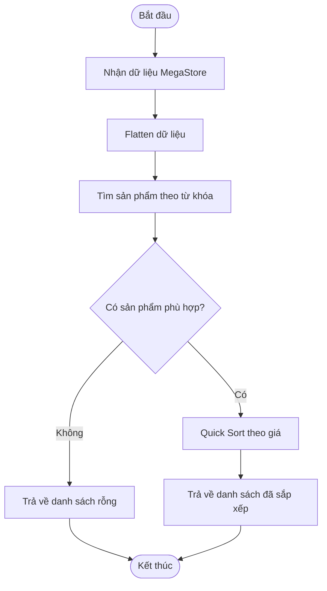

# PERFORMANCE REPORT – MEGASTORE ALGORITHM OPTIMIZER

## 1. MÔI TRƯỜNG KIỂM THỬ

| Thành phần   | Thông số                                 |
| ------------ | ---------------------------------------- |
| CPU          | Intel(R) Core(TM) i7-6600U CPU @ 2.60GHz |
| RAM          | 7.89 GB (xấp xỉ 8 GB)                    |
| Node.js      | v22.14.0                                 |
| Hệ điều hành | Windows (chưa xác định phiên bản)        |

## 2. KẾT QUẢ BENCHMARK LEGACY VS OPTIMIZED

Đơn vị thời gian: milliseconds (ms).

| Số lượng sản phẩm | Legacy (ms) | Optimized (ms) | Phương pháp nhanh hơn |
| ----------------: | ----------: | -------------: | --------------------- |
|             1.000 |       0.856 |          1.366 | Legacy                |
|            10.000 |       3.045 |          3.638 | Legacy                |
|           500.000 |     547.757 |        154.749 | Optimized             |

### 2.1. Phân tích kết quả

**Với 1.000 sản phẩm:**

Legacy mất 0.856 ms, trong khi Optimized mất 1.366 ms. Legacy nhanh hơn do Optimized phải thực hiện thêm bước Flatten và các thao tác xử lý phụ.

**Với 10.000 sản phẩm:**

Legacy mất 3.045 ms, Optimized mất 3.638 ms. Ở quy mô dữ liệu này, chi phí xử lý bổ sung của Optimized vẫn lớn hơn lợi ích từ Quick Sort.

**Với 500.000 sản phẩm:**

Legacy mất 547.757 ms, trong khi Optimized chỉ mất 154.749 ms.

Tính mức cải thiện:

Speedup = 547.757 / 154.749 ≈ 3.54 lần.

Tỷ lệ thời gian tiết kiệm:

(547.757 - 154.749) / 547.757 × 100 ≈ 71.75%.

Như vậy, Optimized nhanh hơn khoảng 3.54 lần và giảm 71.75% thời gian xử lý so với Legacy ở bộ dữ liệu 500.000 sản phẩm.

### 2.2. Kiểm tra tính chính xác

| Số sản phẩm | Kết quả Legacy | Kết quả Optimized | Hai kết quả giống nhau |
| ----------: | -------------: | ----------------: | ---------------------- |
|       1.000 |             10 |                10 | true                   |
|      10.000 |            100 |               100 | true                   |
|     500.000 |          5.000 |             5.000 | true                   |

Hai phương pháp trả về cùng số lượng sản phẩm. Hàm compareResults xác nhận danh sách kết quả giống nhau.

## 3. KẾT QUẢ BENCHMARK LINEAR SEARCH VS BINARY SEARCH

Thực hiện 1.000 lần tìm kiếm trên từng bộ dữ liệu.

| Số sản phẩm | Linear Search × 1.000 | Binary Search × 1.000 |
| ----------: | --------------------: | --------------------: |
|       1.000 |             10.008 ms |              8.047 ms |
|      10.000 |             87.861 ms |                0.2 ms |
|     500.000 |              25.553 s |              0.274 ms |

### 3.1. Kiểm tra kết quả tìm kiếm

| Số sản phẩm | Giá cần tìm | Linear Search trả về | Binary Search trả về |
| ----------: | ----------: | -------------------: | -------------------: |
|       1.000 |      10.490 |                  999 |                  999 |
|      10.000 |     100.490 |                9.999 |                9.999 |
|     500.000 |   5.000.490 |              499.999 |              499.999 |

Cả hai thuật toán đều tìm thấy sản phẩm cần tìm và trả về cùng vị trí.

### 3.2. Phân tích kết quả

Ở bộ dữ liệu 500.000 sản phẩm:

- Linear Search mất 25.553 giây cho 1.000 lần tìm kiếm.
- Binary Search mất 0.274 mili giây cho 1.000 lần tìm kiếm.

Tính mức chênh lệch:

Speedup = 25.553.000 / 0.274 ≈ 93.259 lần.

Binary Search nhanh hơn khoảng 93.259 lần trong lần đo này.

Nguyên nhân:

- Linear Search kiểm tra lần lượt từng phần tử cho đến khi tìm thấy giá trị cần tìm.
- Binary Search liên tục chia đôi phạm vi tìm kiếm và loại bỏ một nửa phạm vi sau mỗi bước.

**Lưu ý:** Binary Search yêu cầu mảng đã được sắp xếp theo giá trước khi tìm kiếm. Thời gian sắp xếp dữ liệu không được tính trong phép đo tìm kiếm này.

## 4. PHÂN TÍCH ĐỘ PHỨC TẠP BIG O

Gọi:

- n là tổng số sản phẩm đầu vào.
- k là số sản phẩm phù hợp với từ khóa tìm kiếm.

| Thuật toán    | Độ phức tạp thời gian                 |
| ------------- | ------------------------------------- |
| Flatten       | O(n)                                  |
| Linear Search | O(n)                                  |
| Binary Search | O(log n)                              |
| Bubble Sort   | Trung bình và xấu nhất O(k²)          |
| Quick Sort    | Trung bình O(k log k), xấu nhất O(k²) |

### 4.1. Phân tích Legacy

Legacy thực hiện:

1. Duyệt danh sách sản phẩm và tìm kiếm theo từ khóa: O(n).
2. Sắp xếp các sản phẩm tìm được bằng Bubble Sort: trung bình O(k²).

Tổng độ phức tạp thời gian trung bình:

O(n + k²).

### 4.2. Phân tích Optimized

Optimized thực hiện:

1. Flatten dữ liệu: O(n).
2. Tìm sản phẩm theo từ khóa: O(n).
3. Sắp xếp sản phẩm bằng Quick Sort: trung bình O(k log k).

Tổng độ phức tạp thời gian trung bình:

O(n + k log k).

Khi số lượng sản phẩm phù hợp k tăng lớn, Quick Sort có lợi thế rõ rệt so với Bubble Sort.

## 5. PHÂN TÍCH BỘ NHỚ CỦA FLATTEN

Hàm Flatten tạo một mảng mới chứa toàn bộ sản phẩm sau khi làm phẳng dữ liệu.

- Độ phức tạp thời gian: O(n), vì phải duyệt qua tất cả sản phẩm.
- Độ phức tạp không gian phụ: O(n), vì tạo một mảng kết quả mới chứa n phần tử.
- Các đối tượng sản phẩm không được sao chép sâu. Mảng mới chỉ lưu các tham chiếu đến những đối tượng ban đầu.

Như vậy, Flatten sử dụng thêm bộ nhớ tỷ lệ thuận với số lượng sản phẩm đầu vào.

## 6. FLOWCHART QUY TRÌNH OPTIMIZED

## 7. SO SÁNH QUICK SORT VÀ MERGE SORT

| Tiêu chí             | Quick Sort                    | Merge Sort                        |
| -------------------- | ----------------------------- | --------------------------------- |
| Ý tưởng              | Chọn pivot và phân hoạch mảng | Chia mảng thành các phần rồi trộn |
| Thời gian trung bình | O(n log n)                    | O(n log n)                        |
| Thời gian xấu nhất   | O(n²)                         | O(n log n)                        |
| Bộ nhớ phụ           | Trung bình O(log n)           | O(n)                              |
| Tính ổn định         | Thông thường không ổn định    | Có thể ổn định                    |

### 7.1. Quick Sort

Quick Sort chọn một phần tử làm pivot, sau đó phân hoạch mảng thành các vùng nhỏ hơn, bằng và lớn hơn pivot. Tiếp tục sắp xếp các vùng ngoài bằng đệ quy.

Ưu điểm:

- Hiệu năng thực tế thường tốt.
- Có thể sắp xếp trực tiếp trên mảng ban đầu.
- Không cần mảng phụ O(n) như Merge Sort.

Nhược điểm:

- Có thể đạt O(n²) nếu phân hoạch mất cân bằng.
- Độ sâu đệ quy có thể tăng lớn trong trường hợp xấu nhất.

Trong bài thực hành, Quick Sort sử dụng median-of-three và phân hoạch 3 vùng để giảm nguy cơ phân hoạch mất cân bằng và xử lý hiệu quả các phần tử có giá trị trùng nhau.

### 7.2. Merge Sort

Merge Sort chia mảng thành hai nửa, tiếp tục chia nhỏ cho đến khi mỗi phần chỉ còn một phần tử. Sau đó trộn các phần đã sắp xếp thành mảng lớn hơn.

Ưu điểm:

- Đảm bảo O(n log n) trong cả trường hợp tốt, trung bình và xấu nhất.
- Có thể là thuật toán sắp xếp ổn định.

Nhược điểm:

- Thường cần thêm O(n) bộ nhớ phụ đối với mảng.
- Phải thực hiện bước trộn các mảng sau khi chia.

## 8. NGUYÊN LÝ CHIA ĐỂ TRỊ (DIVIDE AND CONQUER)

Chia để trị là phương pháp giải quyết bài toán lớn bằng cách chia nó thành những bài toán nhỏ hơn.

Gồm ba bước:

1. Divide (Chia): Chia bài toán lớn thành các bài toán nhỏ.
2. Conquer (Giải quyết): Giải quyết từng bài toán nhỏ, thường bằng đệ quy.
3. Combine (Kết hợp): Kết hợp kết quả để giải quyết bài toán ban đầu.

Đối với Quick Sort:

- Chọn pivot.
- Phân hoạch các phần tử thành ba vùng.
- Tiếp tục sắp xếp hai vùng ngoài bằng đệ quy.

Quick Sort không cần bước ghép hai mảng đã sắp xếp như Merge Sort vì quá trình phân hoạch đã đưa các phần tử về đúng vùng tương đối.

## 9. KẾT LUẬN

Kết quả benchmark cho thấy phương pháp Optimized có ưu thế rõ rệt khi xử lý bộ dữ liệu lớn.

Với 500.000 sản phẩm, Optimized nhanh hơn Legacy khoảng 3.54 lần và giảm khoảng 71.75% thời gian xử lý.

Đối với tìm kiếm chính xác trên mảng đã sắp xếp, Binary Search thể hiện ưu thế rất lớn so với Linear Search. Ở bộ dữ liệu 500.000 sản phẩm, Binary Search nhanh hơn khoảng 93.259 lần trong lần đo này.

Tuy nhiên, Optimized không nhanh hơn trong mọi trường hợp. Với dữ liệu nhỏ, chi phí xử lý bổ sung có thể khiến thời gian thực thi cao hơn.

Qua bài thực hành, có thể thấy việc lựa chọn thuật toán cần dựa trên kích thước dữ liệu, đặc điểm dữ liệu và chi phí xử lý tổng thể, không chỉ dựa vào tên thuật toán hay độ phức tạp lý thuyết.

## 10. GHI CHÚ VỀ ĐỘ TIN CẬY KẾT QUẢ

Các số liệu trong báo cáo được ghi nhận từ một lần chạy benchmark trên máy tính nêu tại mục 1.

Thời gian thực thi có thể thay đổi tùy theo tình trạng CPU, các tiến trình chạy nền và cơ chế tối ưu JIT của Node.js.

Để tăng độ tin cậy, có thể chạy benchmark nhiều lần và tính thời gian trung bình trước khi đưa ra kết luận cuối cùng.
